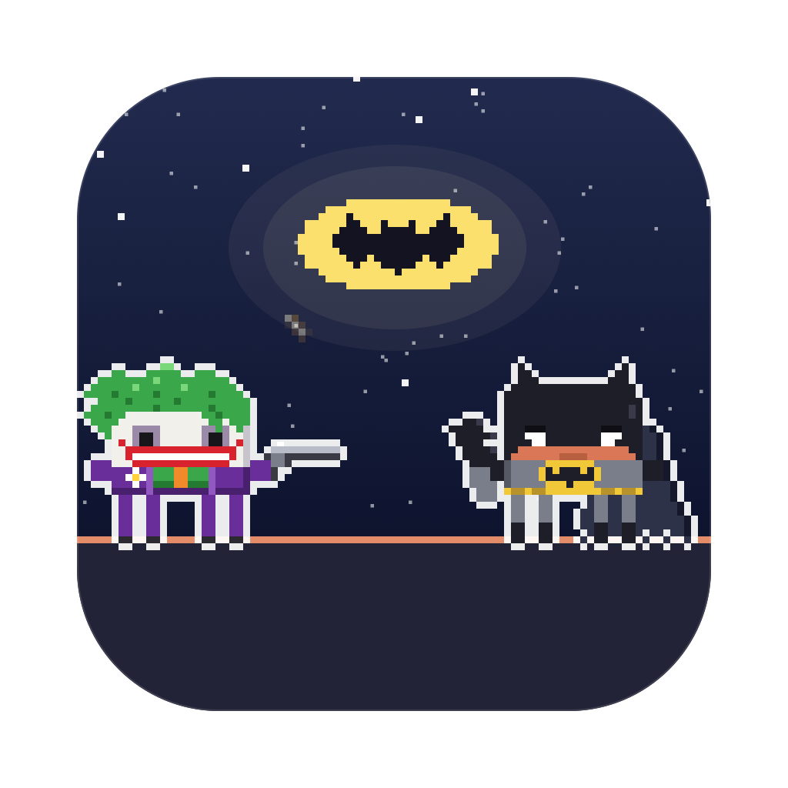
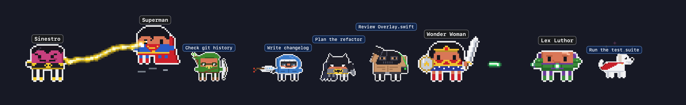
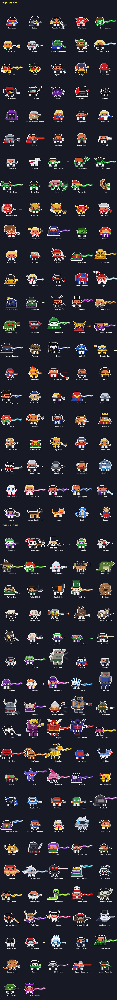
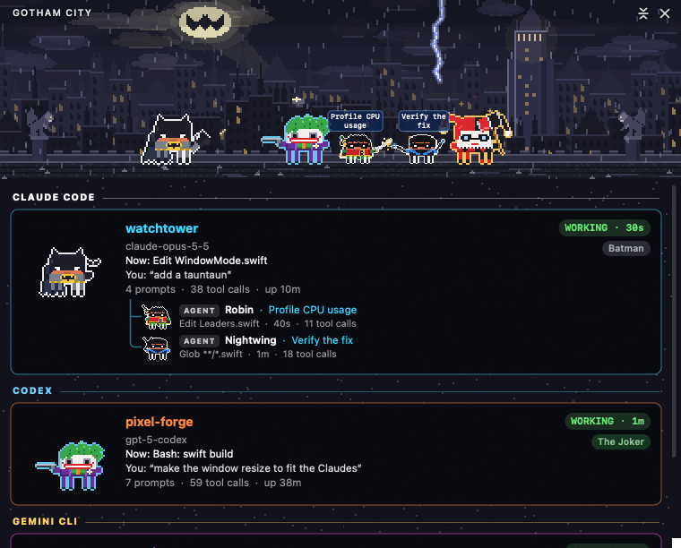
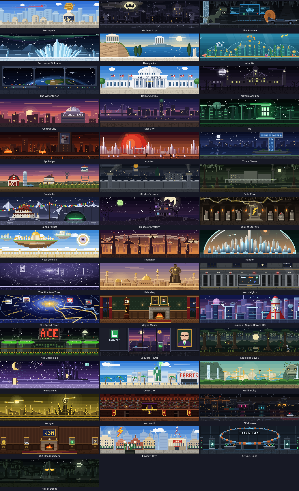

<p align="center">
  
</p>

<h1 align="center">Justice League: Clawd Wars</h1>

<p align="center">
  <b>Your Claude Code, Codex, Qwen Code, Gemini CLI and GitHub Copilot CLI sessions, as a pixel-art DC battle on your desktop.</b><br>
  Every session is a hero or a villain, every subagent joins in, and they fight while they work.
</p>

<p align="center">
  <a href="LICENSE"></a>
  
  
  
  
</p>

https://github.com/user-attachments/assets/4e242255-e81c-4404-b4f0-06c967dc8a56

<p align="center"><sub>🔊 <b>Click the speaker in the player for sound</b>: GitHub starts videos muted. Full 1080p version: <a href="promo/justice-league-clawd-wars-promo.mp4">promo/justice-league-clawd-wars-promo.mp4</a></sub></p>

<p align="center">
  
</p>

---

## Contents

- [Why you want this](#why-you-want-this)
- [Claude vs Codex vs everyone](#claude-vs-codex-vs-everyone)
- [The roster](#the-roster)
- [How they fight](#how-they-fight)
- [Window mode and the screen saver](#window-mode-and-the-screen-saver)
- [The little things](#the-little-things)
- [Install](#install)
- [How it works](#how-it-works)
- [Uninstall](#uninstall)
- [Contributing](#contributing)
- [License](#license)

## Why you want this

You run Claude Code in three terminals. One is thinking, one is waiting for your permission, one finished ten minutes ago and you didn't notice. You alt-tab around to find out.

**Justice League: Clawd Wars tells you at a glance, without switching windows.**

- 🦇 **Working?** Your Claude fights: Batman throws punches, Superman fires heat vision from his eyes, Green Lantern fires his ring.
- 💭 **Thinking?** A thought bubble.
- ❗ **Needs you?** A red `!`, and if you ignore it for a minute, it starts jumping up and down. It keeps asking until you answer, however long that takes; press Esc instead and it stands down.
- 😴 **Done and idle?** It stops fighting and stands about with habits of its own every 10–20 seconds: it glances over its shoulder, shifts its weight, twirls its weapon, checks its gun, lets magic crackle in its hand. And nearly everyone has a move all their own: Batman throws a batarang that loops back to his hand, the Joker's revolver pops out a BANG! flag, the Flash vanishes and comes back with a coffee, Zatanna taps her hat and a dove flies out, Two-Face flips his coin, Mr. Freeze holds up his snow globe, Lobo blows smoke rings, King Shark eats a fish ("Nom nom"), Zan and Jayna fist-bump into an ice block and an eagle, and Mr. Mxyzptlk says his name backwards and pops out of existence. After a couple of minutes it sits down; after five it's asleep (zZz).
- 🦸 **Spawned subagents?** They walk (or fly, or swing on a grapnel line) in one by one, each labelled with *what it's doing*, and they leave when they finish. Flyers take off; the Bat-family gets picked up by the Batwing, and Green Arrow, Black Canary and the other Leaguers who don't fly by the Javelin.
- 🔍 **Want details?** Hover any character: status, how long, the tool it's running right now, your last prompt.
- 🖱️ **Click any of them** to jump straight to that session's terminal or VS Code tab.

It sits on the bottom of your screen, above every window, and it's click-through everywhere except the characters. No dashboard to open, no tab to check.

## Claude vs Codex vs everyone

**Claude Code plays the heroes.** Run it alongside **OpenAI Codex**, **Qwen Code**, **Gemini CLI** or **GitHub Copilot CLI** and Claude's sessions and agents are the Justice League and friends, while the other AI's are the Joker, Lex Luthor, Darkseid and the rest. With only Claude running, anyone can turn up, so heroes and villains mix.

You can tell the AIs apart at a glance: Claude's characters keep the white outline; Codex gets cyan, Qwen Code lavender, Gemini CLI gold and Copilot CLI mint. Claude Code sessions in the **Claude desktop app** have a coral outline.

## The roster

Every character is Clawd (Claude Code's little pixel mascot) in costume, drawn in code: no sprite sheets, no image assets (even the app icon is rendered by the same code). Nearly every one has a signature move it does when idle.

<p align="center">
  
</p>

**110 heroes**: Superman, Batman, Wonder Woman, The Flash, Green Lantern, Aquaman, Cyborg, Martian Manhunter, Green Arrow, Black Canary, Shazam, Robin, Nightwing, Batgirl, Red Hood, Red Robin, Catwoman, Huntress, Batwoman, Orphan, Spoiler, Commissioner Gordon, Supergirl, Superboy, Power Girl, Steel, Jon Kent, Lois Lane, Jimmy Olsen, Alfred, Lucius Fox, Krypto, John Stewart, Guy Gardner, Kyle Rayner, Jessica Cruz, Simon Baz, Kilowog, Tomar-Re, Ch'p, Adam Strange, Hawkman, Hawkgirl, Wally West, Jay Garrick, Impulse, Jesse Quick, Raven, Beast Boy, Starfire, Wonder Girl, Aqualad, Arsenal, Alan Scott, Doctor Fate, Hourman, Stargirl, Wildcat, Atom Smasher, Cyclone, Doctor Mid-Nite, Sandman, Mister Terrific, Zatanna, Constantine, Swamp Thing, Deadman, The Spectre, Etrigan, Madame Xanadu, Phantom Stranger, Ragman, Dream, Blue Beetle, Booster Gold, The Atom, Firestorm, Plastic Man, Elongated Man, Vixen, Black Lightning, The Question, Metamorpho, Red Tornado, Captain Atom, Mera, Artemis, Donna Troy, Nubia, Hippolyta, Steve Trevor, Mister Miracle, Big Barda, Orion, Animal Man, Katana, Peacemaker, Bloodsport, Ratcatcher 2, King Shark, Polka-Dot Man, Saturn Girl, Cosmic Boy, Lightning Lad, Zan, Jayna, Ace the Bat-Hound, Streaky, Gleek and Beppo. Krypto, Ch'p, Ace, Streaky, Gleek and Beppo only ever show up as agents.

**97 villains**: The Joker, Harley Quinn, The Penguin, The Riddler, Two-Face, Scarecrow, Poison Ivy, Mr. Freeze, Bane, Killer Croc, Ra's al Ghul, Talia al Ghul, Deathstroke, Mad Hatter, Clayface, Hush, Victor Zsasz, Firefly, Man-Bat, The Ventriloquist, Talon, Calendar Man, Joker Goon, Lex Luthor, General Zod, Ursa, Brainiac, Doomsday, Bizarro, Metallo, Parasite, Toyman, Mr. Mxyzptlk, Livewire, Darkseid, Steppenwolf, DeSaad, Granny Goodness, Kalibak, Parademon, Lobo, Mongul, Trigon, Anti-Monitor, Sinestro, Atrocitus, Larfleeze, Parallax, Manhunter, Dex-Starr, Amazo, Starro, Despero, Eclipso, Reverse-Flash, Zoom, Captain Cold, Heat Wave, Mirror Master, Gorilla Grodd, Weather Wizard, Captain Boomerang, The Trickster, Savitar, Golden Glider, Cheetah, Ares, Circe, Maxwell Lord, Doctor Poison, Giganta, Silver Swan, Black Manta, Ocean Master, The Trench, Black Adam, Doctor Sivana, Mister Mind, Brother Blood, Solomon Grundy, Vandal Savage, Felix Faust, Klarion, Monsieur Mallah, Gentleman Ghost, Black Mask, Deadshot, Killer Frost, Amanda Waller, Enchantress, Copperhead, Cheshire, Black Hand, Cyborg Superman, League Assassin, Kobra Agent and Star Sapphire. The Joker's goons, Dex-Starr and Mister Mind only ever show up as agents.

## How they fight

| Style | Who | What happens |
|---|---|---|
| melee vs melee | fists, swords, staffs, maces, tridents, claws | they close in and duel; blows clash with sparks (the giants stand back a bit) |
| ranged vs melee | heat vision, arrows, bullets, cold guns vs Batman, Wonder Woman, Aquaman… | the shots come in, the bracelets, trident or fists knock each one away |
| magic vs melee | the Lanterns' rings, Zatanna, Doctor Fate, Raven vs a blade or fist | the weapon holds the stream back |
| magic vs ranged | | the gunner gets zapped |
| ranged vs ranged | | a proper shoot-out: they duck, shots collide mid-air, armour flashes, shots ping off |
| odd one out | | cheers the others on, with sparkles |

Every shooter has its own shots: Superman's and Zod's heat vision, Darkseid's Omega Beams, Green Arrow's and Huntress' arrows, Captain Cold's and Mr. Freeze's ice, Heat Wave's and Firefly's fire, Captain Boomerang's boomerangs, the Toyman's toys. Ring and magic streams come in each wielder's colours: the Green Lanterns green, Sinestro yellow, Atrocitus red, Larfleeze orange, Star Sapphire violet, Black Lightning and Shazam as forked lightning.

**Arch-enemies find each other first**: whenever both are fighting, Batman takes on the Joker (or Bane, Ra's al Ghul, the Riddler…), Superman takes Lex Luthor, Doomsday or Zod, Wonder Woman the Cheetah or Ares, the Flash Reverse-Flash, Green Lantern Sinestro, Aquaman Black Manta, Shazam Black Adam, Raven Trigon, Orion Darkseid, and more, wherever they are in the line.

**They move like themselves**: Superman, Wonder Woman, the Lanterns, the Hawks and the other flyers take off when they cross the stage and land where they're going (and fly away when they're done); Doctor Fate, Raven, Brainiac and the Spectre hover; Batman, Nightwing and Batgirl swing on grapnel lines.

## Window mode and the screen saver

It opens in a window by default (switch to the desktop from the menu): the whole crew in a scene, with a card for every session: its project, what it's doing right now, your last prompt, its last reply, and its agents in a little tree.

<p align="center">
  
</p>

The scene is set **where the first session's character belongs**: the Fortress of Solitude for Superman, the Batcave for Batman, Themyscira for Wonder Woman, Apokolips for Darkseid. 43 places, each with something moving: the Bat-Signal on the clouds over rainy Gotham, the Daily Planet's globe turning while a red-blue blur streaks past, bats round the Batcave's waterfall and the Batcomputer scrolling, the aurora over the Fortress of Solitude, the Earth turning below the Watchtower's window as the Javelin glides by, searchlights and lightning over Arkham, Green Lanterns streaking past the Central Power Battery on Oa, Parademons over Apokolips' fire pits, Krypton quaking under its red sun, acid bubbling at Ace Chemicals, the kryptonite glowing in Lex's office, the Lazarus Pit bubbling in Nanda Parbat, lightning striking the wizard's throne on the Rock of Eternity, Brainiac's face looming over Kandor's bell, the fire and the stopped grandfather clock in Wayne Manor, and the Hall of Doom's eyes glowing over the swamp:

<p align="center">
  
</p>

**43 places**: Metropolis, Gotham City, the Batcave, the Fortress of Solitude, Themyscira, Atlantis, the Watchtower, the Hall of Justice, Arkham Asylum, Central City, Star City, Oa, Apokolips, Krypton, Titans Tower, Smallville, Stryker's Island, Belle Reve, Nanda Parbat, the House of Mystery, the Rock of Eternity, New Genesis, Thanagar, Kandor, the Phantom Zone, Kahndaq, Iron Heights, the Speed Force, Wayne Manor, the Legion of Super-Heroes HQ, Ace Chemicals, LexCorp Tower, the Louisiana Bayou, the Dreaming, Coast City, Gorilla City, Korugar, Warworld, Blüdhaven, JSA Headquarters, Fawcett City, S.T.A.R. Labs and the Hall of Doom.

**Comic-book transitions.** Whenever the place changes, in the window or the screen saver, one of 15 transitions plays, never the same one twice in a row: the Flash tearing through in red and yellow lightning (WHOOSH!), the Bat-Signal lighting up the sky until its circle is the new place, Superman punching through the page (KRAASH!), the Lasso of Truth crumpling the panel and whipping it open, a Green Lantern ring pencilling, inking and colouring the new place, a giant Joker card flipping over (HAHAHA!), an Atlantean wave (SPLAAASH!), Darkseid's Omega Beams blowing the panel apart (KRAKOOM!), a grapnel yanking the panel away (THWIP!), Shazam's lightning turning the page black and white, Harley's mallet (KAPOW!), Doctor Fate's ankh opening like a door, a vintage comic book's page turning ("MEANWHILE, IN GOTHAM CITY…"), Cyborg's digital glitch, and the multiverse's vortex of alternate panels. Whoever's on screen, and where the trip is going, makes their own come up more often.

**The screen saver** (Settings → Install Screen Saver…) shows the window's place full screen with the crew fighting across its floor, a card per session, name tags over every head, a clock and a crawl of what happened lately. Every 10 minutes it moves somewhere new with a comic-book transition (see below). With nothing running, it puts on a show of its own: a random crew of heroes against villains, a local or two among them.

## The little things

| You see | It means |
|---|---|
| fighting | Claude is running tools |
| 💭 thought bubble | thinking |
| red `!` | waiting for your permission, **jumping** after a minute |
| `?` | that session started before the hooks were installed; restart it for live status |
| sitting on the floor | idle for 2+ minutes |
| zZz | idle for 5+ minutes |
| bobbing yellow marker | the Claude whose terminal you're looking at right now |
| matching label colours | a Claude and its agents share their project's colour |

- **Double-click the S-shield in the menu bar** to hide or show the crew; a single click opens the menu.
- **Drag** the crew anywhere on either monitor; **hover** for a details card; **click** to jump to the exact terminal tab or editor window.
- **Status Symbols** in the menu is the same key, drawn with the app's own sprites.
- Hold **⌘** in the menu for the **Playground** (put anyone on stage and watch them fight) and Demo Mode.

## Install

Needs macOS 13+ (Apple Silicon or Intel) and at least one of [Claude Code](https://claude.com/claude-code), [Codex](https://developers.openai.com/codex), [Qwen Code](https://github.com/QwenLM/qwen-code), [Gemini CLI](https://github.com/google-gemini/gemini-cli) or [GitHub Copilot CLI](https://github.com/github/copilot-cli). It asks before connecting any of them, and only touches the ones you connect.

**It keeps to itself.** It has its own name, hook (`justice-hook`), status file and screen saver, and only ever adds or removes its own hook entries, so other hooks in your settings are left alone.

**From source** (no Xcode project, no packages, only Apple's free Command Line Tools):

```sh
xcode-select --install     # one time, if you don't have the developer tools
git clone https://github.com/rodclemen/justice-league-clawd-wars.git && cd justice-league-clawd-wars
./build.sh --no-install    # build and run the copy in build/: nothing installed, no AI's settings changed
./build.sh                 # build, install "Justice League Clawd Wars.app" to /Applications, refresh connected hooks, launch
```

Claude Code sessions that were already running pick up the hooks after a restart (`/exit`, then `claude --continue`). Until then they still show up, with a `?`.

> **Codex users:** Codex only runs hooks you've approved. After connecting it, run **`/hooks`** in Codex once and approve Justice League: Clawd Wars.

Clicking to jump to a session in Terminal or iTerm2 asks once for **Automation** permission; jumping to VS Code or Cursor asks once for **Accessibility** permission.

**If the build fails:**

- *"xcrun: error: invalid active developer path"*: the developer tools aren't installed. Run `xcode-select --install`.
- *"You have not agreed to the Xcode license"*: run `sudo xcodebuild -license accept`.
- *Odd compiler errors with Xcode installed*: `xcode-select -p` shows which toolchain is used. Point it at Xcode (`sudo xcode-select -s /Applications/Xcode.app`) or at the Command Line Tools (`sudo xcode-select -s /Library/Developer/CommandLineTools`).
- It signs with your Apple Development certificate if you have one, otherwise ad hoc. Ad hoc is fine, but macOS then forgets the Accessibility permission after every rebuild.

## How it works

- A tiny Foundation-only binary, `justice-hook`, is registered for each connected AI's hook events (session start/end, prompts, tool calls, permission requests, subagents, stop). It writes `~/.claude/justice-status/state.json` under a file lock and exits silently, so it can never get in Claude's way.
- The app reads that twice a second, finds sessions without hooks from the process table, and drops a session the moment its process exits.
- Everything you see (the characters, weapons, effects, locations, ships and the icon) is pixel art drawn in Swift at runtime. Only the characters and the place on screen are ever drawn.
- The first install backs up each AI's settings (`…before-justice-league-clawd-wars`).

## Uninstall

Menu bar S-shield → **Settings → Remove … Hooks** for each connected AI, then **Quit**. Or from the terminal:

```sh
"/Applications/Justice League Clawd Wars.app/Contents/MacOS/JusticeLeagueClawdWars" --uninstall-hooks
rm -rf "/Applications/Justice League Clawd Wars.app" ~/.claude/justice-status
```

## Contributing

Characters and places are data plus drawing code, with no assets to wrangle:

- **A character** is a `Persona` (name, weapon, how it moves, what its shots or magic look like, its signature move) registered next to its drawing function in one of the `Sources/App/Art/*.swift` files. Add its case at the **end** of `Companion` (heroes) or `Leader` (villains) in `Sources/App/Roster.swift` (ids are saved, so never reorder; villains must stay under 100), give it a home in `Location.home(of:)`, and bump the count in `Sources/Shared/StatusStore.swift`. `Sources/App/Pose.swift` explains what a drawing function gets and must do.
- **A place** is a `Place` in one of the `Sources/App/Places/*.swift` files: a still picture and an optional moving layer.
- **Check it** with the preview tool: `Tools/Preview/build.sh`, then `build/preview cast out.png batman` (every pose), `build/preview fight out.png batman joker`, `build/preview place out.png gotham`, `build/preview rides out.png`. Regenerate the README sheets with `Tools/RenderDocs` and the icon with `Tools/MakeIcon`.

## License

**Free to use.** The code is [MIT licensed](LICENSE): use it, change it, share it, just keep the license notice.

---

<p align="center"><sub>A fan project. DC and its characters belong to DC/Warner Bros. Discovery; Claude and Clawd belong to Anthropic.<br>Not affiliated with or endorsed by either.</sub></p>
