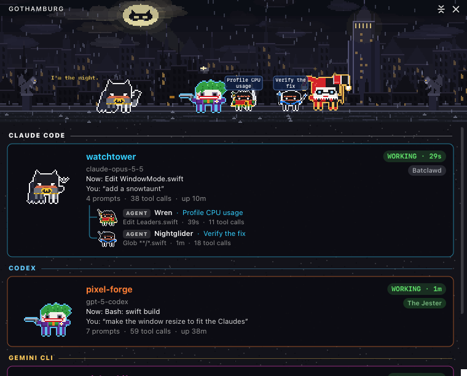

<p align="center">
  
</p>

<h1 align="center">Clawstice League: Clawd Wars</h1>

<p align="center">
  <b>Your Claude Code, Codex, Qwen Code, Gemini CLI and GitHub Copilot CLI sessions, as a pixel-art Detective Claws battle on your desktop.</b><br>
  Every session is a hero or a villain, every subagent joins in, and they fight while they work.
</p>

<p align="center">
  <a href="LICENSE"></a>
  
  
  <a href="https://github.com/rodclemen/clawd-clash"></a>
  
</p>

https://github.com/user-attachments/assets/4e242255-e81c-4404-b4f0-06c967dc8a56

<p align="center"><sub>🔊 <b>Click the speaker in the player for sound</b>: GitHub starts videos muted. Full 1080p version: <a href="promo/justice-league-clawd-wars-promo.mp4">promo/justice-league-clawd-wars-promo.mp4</a></sub></p>

> **Clawstice League: Clawd Wars is now part of [Clawd Clash](https://github.com/rodclemen/clawd-clash)**, one app with three universes. This page shows off its Detective Claws universe; the app, its source and everything else live over there. [Get it below.](#get-it)

<p align="center">
  
</p>

---

## Contents

- [What it is](#what-it-is)
- [Detective Claws](#detective-claws)
- [The roster](#the-roster)
- [The places](#the-places)
- [Window mode and the screen saver](#window-mode-and-the-screen-saver)
- [Get it](#get-it)
- [What's new](#whats-new)

## What it is

You run Claude Code in three terminals. One is thinking, one is waiting for your permission, one finished ten minutes ago and you didn't notice. You alt-tab around to find out.

**Clawd Clash tells you at a glance, without switching windows**, and in Detective Claws it does it with the Clawstice League and their rogues.

- **Working?** Your Claude fights: Batclaw throws punches, Superb-Man fires heat vision from his eyes, Green Lamplighter fires his ring.
- **Thinking?** A thought bubble.
- **Needs you?** A red `!`, and if you ignore it for a minute, it starts jumping up and down. It keeps asking until you answer; press Esc instead and it stands down.
- **Done and idle?** It stops fighting and passes the time with habits of its own, and nearly everyone has a move all their own: Batclaw's clawarang loops back to his hand, the Jester's revolver pops out a BANG! flag, the Flare vanishes and comes back with a coffee, Zatanya taps her hat and a dove flies out, Double-Face flips his coin, Mr. Frost holds up his snow globe, Lobos blows smoke rings, Shark King eats a fish ("Munch munch"), Zann and Jaina fist-bump into an ice block and an eagle, and Mr. Mxyzptklz says his name backwards and pops out of existence. After a couple of minutes it sits down; after five it's asleep (zZz).
- **Spawned subagents?** They walk (or fly, or swing on a grapnel line) in one by one, each labelled with what it's doing, and leave when they finish.
- **Hover** any character for the details; **click** it to jump straight to that session's terminal or editor tab.

**Claude Code plays the heroes.** Run it alongside Codex, Qwen Code, Gemini CLI or GitHub Copilot CLI and Claude's sessions and agents are the Clawstice League and friends, while the other AI's are the Jester, Lex Lugar, Darksyde and the rest. With only Claude running, anyone can turn up. Each AI keeps its own outline colour, so you can tell them apart at a glance.

## Detective Claws

- **207 characters**: 110 heroes and 97 villains, from the Clawstice League, the Batclaw family and the Green Lamplighter Corps to Batclaw's and Superb-Man's rogues, Apocaclaws and the Legion of Gloom. Every one is Clawd (Claude Code's little pixel mascot) in costume, drawn in code.
- **43 places**, from the Lookout and the Night Grotto to Ohh and the Hall of Gloom, each with something moving.
- **Arch-enemies face off first**: whenever both are fighting, Batclaw takes on the Jester (or Bain, Ra's al Ghoul, the Puzzler…), Superb-Man takes Lex Lugar, Judgment Day or General Zed, Wondrous Woman the Jaguar or Ares, the Flare Reverse-Flare, Green Lamplighter Sinistro, Aquamarine Black Stingray, Captain Thunderbolt Black Abel, Corvina Trigun, Orrion Darksyde, and more, wherever they are in the line.
- **The Lance and the Clawwing**: Emerald Archer, Black Finch and the other Leaguers who don't fly are picked up by the Lance; the Batclaw family by the Clawwing.
- **They move like themselves**: Superb-Man, Wondrous Woman, the Lamplighters and the other flyers take off and land; Doctor Fortune, Corvina, Brain-o-Tron and the Spook hover; Batclaw, Nightglider and Batclaw Girl swing on grapnel lines.
- **Every shooter has its own shots**: Superb-Man's and General Zed's heat vision, Darksyde's Omicron Beams, Emerald Archer's and the Huntswoman's arrows, Captain Chill's and Mr. Frost's ice, Heat Spell's and Fireflier's fire, Captain Kylie's boomerangs. Ring streams come in each wielder's colours: the Green Lamplighters green, Sinistro yellow, Atrocious red, Larfreeze orange, Star Sapphyre violet.
- **Fifteen comic-book transitions** whenever the place changes, never the same one twice in a row: the Flare tearing through the Speed Source in red and yellow lightning (WHOOSH!), the Night Beacon lighting up the sky until its circle is the new place, Superb-Man punching through the page (KRAASH!), the Lariat of Truth crumpling the panel and whipping it open, an emerald ring pencilling, inking and colouring the new place, a giant Jester card flipping over (HAHAHA!), an Atlantean wave (SPLAAASH!), Darksyde's Omicron Beams blowing the panel apart (KRAKOOM!), a grapnel yanking the panel away (FWIP!), Captain Thunderbolt's lightning (KA-ZAM!) turning the page black and white, Harlee Quinn's mallet (KAPOW!), Doctor Fortune's ankh opening like a door, a vintage comic book's page turning ("MEANWHILE, IN GOTHAMBURG…"), Cyb-Org's digital glitch, and the multiverse's vortex of alternate panels. Whoever's on screen, and where the trip is going, makes their own come up more often.
- **The C-shield** in the menu bar: double-click it to hide or show the crew, click it for the menu.

## The roster

<p align="center">
  
</p>

**110 heroes**: Superb-Man, Batclaw, Wondrous Woman, The Flare, Green Lamplighter, Aquamarine, Cyb-Org, Martian Man-Seeker, Emerald Archer, Black Finch, Captain Thunderbolt, Wren, Nightglider, Batclaw Girl, Red Cowl, Red Wren, Cat Burglar, The Huntswoman, Batclaw Woman, The Foundling, Spoilsport, Commissioner Gordo, Superb-Girl, Superb-Boy, Powerful Gal, Steelworks, Jon Kant, Lois Lain, Jimmy Olson, Alfrid the Butler, Lucius Fax, Kryptro, John Steward, Guy Garden, Kyle Rayder, Jessica Cruise, Simon Bas, Kilowag, Tomar-Ru, Ch'pp, Adam Stranger, Hawk-Warrior, Hawk-Maiden, Wally Wes, Jay Carrick, Impulsive, Jessie Quik, Corvina, Feral Boy, Starblaze, Wondrous Girl, Aquamarine Lad, Armoury, Alan Scotch, Doctor Fortune, Minuteman, Star Lass, Alley Cat, Atom Crusher, Twister, Doctor Midnight, The Sleepmaker, Mister Tremendous, Zatanya, Constantin, Bog Thing, Dead Acrobat, The Spook, Etrigal, Madame Xanadoo, Phantom Wanderer, Rag-and-Bone Man, The Dreamer, Blue Scarab, Booster Bling, The Molecule, Flamestorm, Rubber Man, Stretched Man, Vixxen, Black Thunderbolt, The Query, Metamorph, Red Twister, Captain Nucleus, Merra, Artemis, Donna Troya, Nubia, Hippolyta, Steve Trevon, Mister Marvellous, Big Bertha, Orrion, Creature Man, Katanah, Peacekeeper, Bloodsprint, Rat Charmer, Shark King, Spotty Man, Saturn Lass, Cosmos Boy, Thunderbolt Lad, Zann, Jaina, Ace the Batclaw Hound, Streaker, Gleeb and Bippo. Kryptro, Ch'pp, Ace, Streaker, Gleeb and Bippo only ever show up as agents.

**97 villains**: The Jester, Harlee Quinn, The Puffin, The Puzzler, Double-Face, Strawman, Poison Oak, Mr. Frost, Bain, Killer Gator, Ra's al Ghoul, Talya al Ghoul, Deathstrike, The Mad Milliner, Mudface, Shush, Victor Zsazz, Fireflier, Bat-Monster, The Puppeteer, Taloned One, Almanac Man, Jester Goon, Lex Lugar, General Zed, Ursula, Brain-o-Tron, Judgment Day, Bizzaro, Metallox, The Leech, Toymaker, Mr. Mxyzptklz, Live Current, Darksyde, Steppenwulf, DeSade, Granny Kindness, Kalibax, Paradevil, Lobos, Mongol, Trigun, Anti-Watcher, Sinistro, Atrocious, Larfreeze, Parallaxis, Man-Seeker Robot, Dex-Starz, Amazomatic, Starrfish, Desperado, Eclipsor, Reverse-Flare, Zoomer, Captain Chill, Heat Spell, Looking-Glass Master, Gorilla Grudd, Weather Warlock, Captain Kylie, The Prankster, Savitr, Golden Skater, Jaguar, Ares, Circe, Maxwell Laird, Doctor Toxin, Gigantia, Silver Crane, Black Stingray, Sea Master, The Deep Ones, Black Abel, Doctor Savana, Mister Brain-Worm, Brother Gore, Solomon Grundy, Vandal Ravage, Felix Fausto, Clarion, Monsieur Mahala, Gentleman Spectre, Black Visor, Deadeye, Killer Rime, Amanda Wall, Sorceress, Cottonmouth, Cheshyre, Black Glove, Cyb-Org Superb-Man, Assassin of the Shadow League, Cobra-Cult Agent and Star Sapphyre. The Jester's goons, Dex-Starz and Mister Brain-Worm only ever show up as agents.

## The places

The scene is set **where the first session's character belongs**: the Fortress of Loneliness for Superb-Man, the Night Grotto for Batclaw, Themyskira for Wondrous Woman, Apocaclaws for Darksyde. Something moves in every one: the Night Beacon on the clouds over rainy Gothamburg, the Daily Globe's globe turning while a red-blue blur streaks past, bats round the Night Grotto's waterfall, the aurora over the Fortress of Loneliness, the Earth turning below the Lookout's window as the Lance glides by, searchlights and lightning over Ashcombe Asylum, Green Lamplighters streaking past the power battery on Ohh, Paradevils over Apocaclaws' fire pits, Kryptron quaking under its red sun, acid bubbling at Acme Chemicals, the Kryptronite glowing in Lex Lugar's office, lightning striking the wizard's throne on the Rock of Forever, Brain-o-Tron's face looming over Kandoor's bell, the fire and the stopped grandfather clock in Payne Manor, and the Hall of Gloom's eyes glowing over the swamp.

<p align="center">
  
</p>

**43 places**: Megalopolis, Gothamburg, the Night Grotto, the Fortress of Loneliness, Themyskira, Atlantis, the Lookout, the Hall of Clawstice, Ashcombe Asylum, Centre City, Star Harbour, Ohh, Apocaclaws, Kryptron, Clawtans Tower, Smallburg, Striker's Rock, Bayou Penitentiary, Nanga Parbat, the House of Riddles, the Rock of Forever, New Genesys, Thanagor, Kandoor, the Phantasm Zone, Khandaq, Iron Hills Prison, the Speed Source, Payne Manor, the Legion of Super-Clawds HQ, Acme Chemicals, LugarCorp Tower, the Louisiana Bayou, the Dreamlands, Shore City, Ape City, Korugor, Battleworld, Bloodhaven, CSA Headquarters, Faucet City, S.C.A.R. Labs and the Hall of Gloom.

## Window mode and the screen saver

It opens in a window by default (switch to the desktop from the menu): the whole crew in a scene, with a card for every session: its project, what it's doing right now, your last prompt, its last reply, and its agents in a little tree. When no AI is running, the window steps aside, and it comes back when one starts.

<p align="center">
  
</p>

**The screen saver** (Settings… → Screen Saver → Install…) shows the place full screen with the crew fighting across its floor, a card per session, name tags, a clock and a crawl of what happened lately, and moves somewhere new every 10 minutes with one of the fifteen transitions. With nothing running, it puts on a show of its own: a random crew of heroes against villains.

**Two more universes come with it**: **Star Claws** and **Clawvel**. Pick one in **Settings… → Universe**, or pick **Random** and it changes universe on its own every 1, 5, 10, 15, 30 or 60 minutes. A scene never mixes them.

## Get it

Clawstice League: Clawd Wars is now part of **[Clawd Clash](https://github.com/rodclemen/clawd-clash)**. It needs macOS 13+ (Apple Silicon or Intel) and at least one of Claude Code, Codex, Qwen Code, Gemini CLI or GitHub Copilot CLI.

```sh
brew install --cask rodclemen/tap/clawstice-league-clawd-wars
```

That installs Clawd Clash starting in Detective Claws. `brew install --cask rodclemen/tap/clawd-clash` installs the same app, or download the zip from [Clawd Clash's Releases](https://github.com/rodclemen/clawd-clash/releases), unzip it and drag **Clawd Clash** to Applications.

Already have the old app? Clawd Clash takes over the AIs it had connected and starts in Detective Claws, so the old app can go.

Setup, permissions, building from source, uninstalling and everything else: see the [Clawd Clash README](https://github.com/rodclemen/clawd-clash#readme).

## What's new

See [CHANGELOG.md](CHANGELOG.md) for what's new in Clawstice League: Clawd Wars, in plain language.

## License

**Free to use.** [MIT licensed](LICENSE).

---

<p align="center"><sub>An independent parody fan project, not affiliated with or endorsed by DC Comics or Warner Bros. Claude and Clawd belong to Anthropic.</sub></p>
